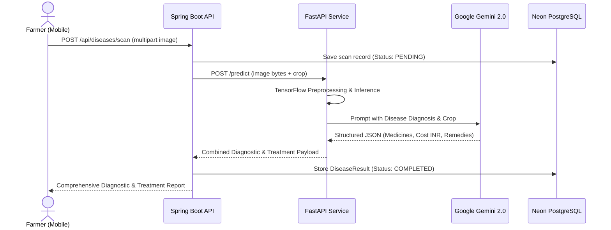
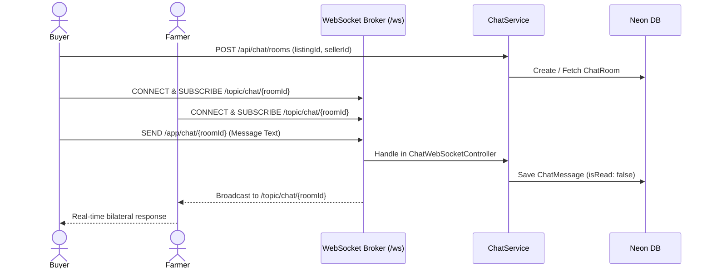
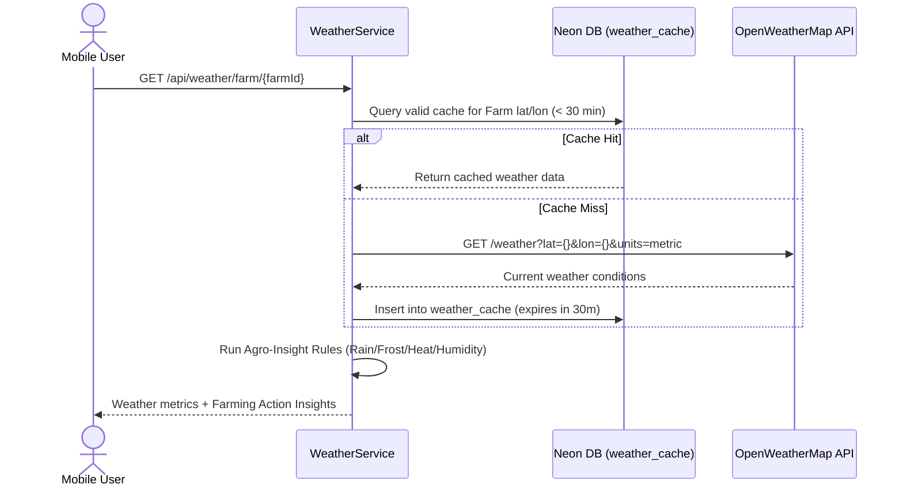

# Krushi-Adhaar — System Architecture Specification

## 1. Executive Summary
**Krushi-Adhaar** is an end-to-end intelligent agricultural management and marketplace platform designed to empower Indian farmers and agricultural buyers. The platform bridges the gap between field management, predictive disease diagnosis, real-time localized agro-advisories, and decentralized farm-to-buyer commerce.

---

## 2. Architecture Overview

```
                                  +------------------------------------+
                                  |         Android Client App         |
                                  |     (Jetpack Compose, MVVM)        |
                                  +-----------------+------------------+
                                                    |
                                    HTTPS REST & WSS STOMP
                                                    |
                                                    v
                                  +------------------------------------+
                                  |     Spring Boot Backend (v3.2.5)   |
                                  |         (Java 17 / Gradle)         |
                                  +--------+------------------+--------+
                                           |                  |
                          Flyway SQL / JDBC|                  | HTTP REST
                                           v                  v
    +----------------------------------------------+   +------------------------------------+
    |              Neon PostgreSQL Cloud           |   |       FastAPI ML Microservice      |
    | (Users, Farms, Listings, Chats, WeatherCache)|   | (TensorFlow 2.x + Gemini 2.0 Flash)|
    +----------------------------------------------+   +-----------------+------------------+
                                                                         |
                                                   OpenWeatherMap & Gemini External APIs
```

---

## 3. Technology Stack

### 3.1 Mobile Client (Android)
- **Framework**: Android Jetpack Compose (Declarative UI)
- **Architecture**: MVVM (Model-View-ViewModel) + Clean Architecture repository pattern
- **Local Persistence**: Room SQLite DB (`KrushiAdhaarDatabase`) + Encrypted SharedPreferences (`TokenStorage`) + State SharedPreferences (`GlobalMockData`)
- **Networking**: Retrofit 2 + OkHttp 3 (with JWT token refresh authenticator)
- **Edge AI**: TensorFlow Lite Interpreter runtime (`org.tensorflow:tensorflow-lite`)

### 3.2 Core Backend (Spring Boot 3.2.5)
- **Language & Runtime**: Java 17, Spring Boot 3.2.5, Gradle 8.7
- **Security**: Spring Security 6 with stateless JWT Bearer token authentication & role-based access control (FARMER, BUYER, AGRI_EXPERT, ADMIN)
- **Database Engine**: Neon Cloud Serverless PostgreSQL (`neondb`)
- **ORM & Migrations**: Spring Data JPA / Hibernate 6 + Flyway DB automated versioned migrations (`V1` through `V16`)
- **Real-Time Communication**: Spring WebSocket with STOMP message broker and SockJS fallback
- **Geospatial Engine**: Haversine formula calculation for farm-to-buyer distances

### 3.3 Artificial Intelligence & Predictive Microservice
- **Framework**: Python 3.9 / FastAPI with Uvicorn ASGI server
- **Disease Classification**: Deep Learning convolutional neural network (CNN) model running on TensorFlow with automated image preprocessing (RGB normalization, 224x224 input sizing)
- **Generative Agro-Advisory**: Google Gemini 2.0 Flash (`google-generativeai`) generating localized treatment recommendations, pesticide dosages, INR cost estimations, and organic remedies
- **Dynamic Agro-Planning**: Weather-adaptive crop recommendations, government scheme discovery, and expense estimation

---

## 4. Database Architecture (Neon PostgreSQL)

### 4.1 Schema Migration Timeline (Flyway)
1. **V1**: Verification schema baseline
2. **V2**: User identity, roles, and refresh tokens
3. **V3**: Farm, fields, crop cycles, farming activities, and harvests
4. **V4**: Disease scan audits and diagnostic results
5. **V5**: Harvest inventories, marketplace listings, orders, and audit logs
6. **V6**: Notification system and registered user devices
7. **V7**: Payment records and idempotency validation
8. **V8**: Order payment deadline expirations
9. **V9**: Order delivery and shipping addresses
10. **V10**: Webhook event idempotency tracking
11. **V11**: Farmer Aadhaar verification and recovery authentication
12. **V12**: Disease prescription medicines and cost estimates
13. **V13**: Geolocation coordinates (`latitude`, `longitude`, `address`, `city`, `state`, `pincode`) for farms and marketplace listings
14. **V14**: Real-time peer-to-peer chat rooms and chat messages
15. **V15**: Smart 30-minute weather cache for OpenWeatherMap integration
16. **V16**: Seeded national agricultural schemes (PM-KISAN, PMFBY, Soil Health Card, PM-KUSUM, eNAM, KCC, etc.)

---

## 5. Key System Workflows

### 5.1 Disease Detection & Advisory Workflow


### 5.2 Real-Time Negotiation & Chat Workflow


### 5.3 Live Weather & Agro-Advisory Workflow


---

## 6. Security & Reliability
- **Stateless Authorization**: JWT token authentication with 1-week refresh tokens stored securely in EncryptedSharedPreferences on mobile.
- **Fail-Safe Fallbacks**: The ML service and weather provider contain automated resilient fallbacks ensuring zero app crashes even when offline or during network disruptions.
- **Data Protection**: Sensitive keys and database credentials reside in `.env` configurations.
